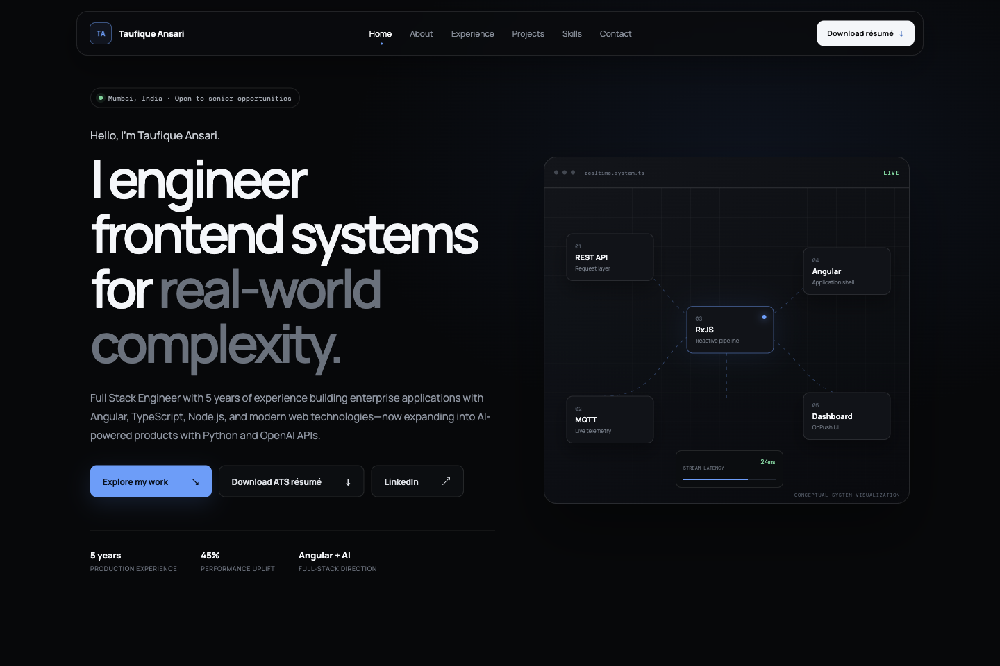

# Taufique Ansari — Portfolio

## UI preview



Actual UI captured from the unchanged public repository served locally. A separate public deployment is not claimed.

[Project screenshots and notes ↗](https://github.com/taufiqueansari2621/project-showcase/blob/main/projects/taufique-portfolio.md) · [More projects ↗](https://github.com/taufiqueansari2621/project-showcase)

Premium personal portfolio for Taufique Ansari, a Full Stack Engineer with 5 years of experience specializing in Angular, Node.js, real-time IoT systems, frontend performance, and AI-powered applications.

## Development

```bash
npm install
npm start
```

Open `http://localhost:4200`.

## Production build

```bash
npm run build
```

The optimized static output is generated in `dist`.

## Tests

```bash
npm test -- --watch=false
```

## Stack

- Angular 22 standalone application
- TypeScript and SCSS
- Responsive, accessible dark-first UI
- IntersectionObserver-powered navigation and reveal motion
- Static production build with SEO metadata

Project visuals are conceptual interface visualizations and do not expose confidential client information.
